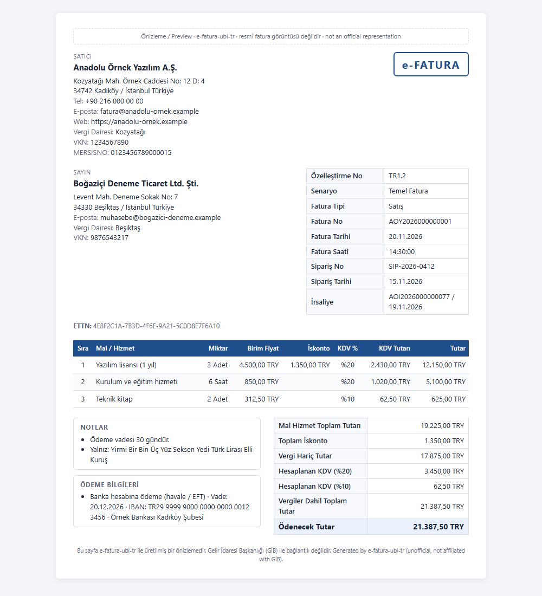

# e-fatura-ubl-tr

[](https://github.com/demiralpozturk/e-fatura-ubl-tr/actions/workflows/ci.yml)


Türk **e-Fatura / e-Arşiv** faturalarını **UBL-TR 1.2** XML formatında üretmek, GİB'in resmî XSD + schematron kurallarıyla doğrulamak ve HTML önizlemesini almak için Python kütüphanesi ve komut satırı aracı.

A Python library and CLI to build Turkish e-Fatura / e-Arşiv invoices in UBL-TR 1.2 XML, validate them against GİB's official XSD + schematron rules, and render an HTML preview. **[English below](#english)**

> **Gayriresmî. Gelir İdaresi Başkanlığı (GİB) ile bağlantılı değildir ve GİB tarafından onaylanmamış / sertifikalandırılmamıştır.** İmzalama (mali mühür / e-imza) ve özel entegratör ya da GİB portalı üzerinden gönderim kapsam dışıdır. Üretimde kullanmadan önce mali müşaviriniz / entegratörünüz ile doğrulayın.
>
> **Unofficial. Not affiliated with or certified by Gelir İdaresi Başkanlığı (GİB). Signing (mali mühür / e-imza) and sending through an özel entegratör or GİB portal are out of scope. Verify with your accountant/integrator before production use.**

Creator: **Demiralp Öztürk** · [GitHub](https://github.com/demiralpozturk) · [LinkedIn](https://www.linkedin.com/in/demiralp-%C3%B6zt%C3%BCrk/)

---

## Türkçe

### Neler yapar?

- **Tipli modeller** (pydantic v2): satıcı/alıcı (VKN veya TCKN, vergi dairesi, adres), fatura satırları (UN/ECE Rec 20 birim kodları, iskonto/artırım), KDV, ÖTV ve benzeri vergiler, **KDV tevkifatı**, istisna kodları, döviz ve kur, notlar, sipariş/irsaliye/iade referansları, ödeme bilgileri.
- **Doğru hesaplama**: `Decimal`, satır bazında `ROUND_HALF_UP` yuvarlama, zincirleme iskonto, ÖTV'nin KDV matrahına eklenmesi, tevkifat. Kurallar aşağıda belgelenmiştir.
- **"Yalnız: … Türk Lirası … Kuruş"** notu (TRY, USD, EUR, GBP …) otomatik eklenir.
- **Yardımcılar**: VKN/TCKN checksum kontrolü (yalnızca algoritmik), fatura numarası (`ABC2026000000001`) üretimi/kontrolü, ETTN (UUID).
- **UBL-TR 1.2 XML**: isim alanları ve eleman sırası GİB'in UBL-TR 1.2.1 şemalarına göre; çıktı imzasızdır.
- **Doğrulama**: GİB'in resmî XSD ve schematron paketleri çalışma anında **GİB'in sitesinden indirilir**, yerel önbelleğe alınır ve `lxml` + XPath 2.0 schematron yorumlayıcısı ile doğrulanır. GİB dosyaları depoya konmaz ([neden?](docs/gib-files.md)).
- **HTML önizleme**: sıfırdan yazılmış, bağımsız bir şablon (GİB'in XSLT'si kullanılmaz).
- **CLI**: `efatura build | validate | preview | schemas | words | check-id`.

### Kurulum

Paket henüz PyPI'da yayınlanmadı. Depodan kurulum:

```bash
pip install "git+https://github.com/demiralpozturk/e-fatura-ubl-tr.git"
```

Geliştirme için:

```bash
git clone https://github.com/demiralpozturk/e-fatura-ubl-tr.git
cd e-fatura-ubl-tr
python -m venv .venv && source .venv/bin/activate   # Windows: .venv\Scripts\activate
pip install -e ".[dev]"
```

Python 3.10+ gerekir. Bağımlılıklar: `pydantic`, `lxml`, `elementpath`.

### Hızlı başlangıç

```python
from datetime import date
from decimal import Decimal

from efatura_ubl_tr import Address, Invoice, InvoiceLine, Party, Profile

satici = Party(
    vkn="1234567890",
    name="Anadolu Örnek Yazılım A.Ş.",
    tax_office="Kozyatağı",
    address=Address(
        street="Örnek Caddesi", building_number="12", city_subdivision="Kadıköy", city="İstanbul"
    ),
)
alici = Party(
    vkn="9876543217",
    name="Boğaziçi Deneme Ticaret Ltd. Şti.",
    tax_office="Beşiktaş",
    address=Address(city_subdivision="Beşiktaş", city="İstanbul"),
)

fatura = Invoice(
    number="AOY2026000000010",
    issue_date=date(2026, 11, 27),
    profile=Profile.TICARIFATURA,
    supplier=satici,
    customer=alici,
    lines=[
        InvoiceLine(name="Yazılım lisansı", quantity=3, unit_price=Decimal("4500"), kdv_rate=20),
        InvoiceLine(name="Teknik kitap", quantity=2, unit_price=Decimal("312.50"), kdv_rate=10),
    ],
)

hesap = fatura.calculate()
print(hesap.tax_exclusive, hesap.tax_total, hesap.payable)  # 14125.00 2762.50 16887.50

xml_bytes = fatura.to_xml()  # imzasız UBL-TR 1.2 XML (UTF-8)
with open("fatura.xml", "wb") as f:
    f.write(xml_bytes)
```

Tevkifatlı bir satır (temizlik hizmeti, 9/10):

```python
from efatura_ubl_tr import InvoiceType, Withholding

InvoiceLine(
    name="Ofis temizlik hizmeti",
    quantity=1,
    unit_code="MON",
    unit_price=Decimal("45000"),
    kdv_rate=20,
    withholding=Withholding(code="612"),
)  # oran koddan gelir (%90)
# Invoice(..., type=InvoiceType.TEVKIFAT, ...)
```

Doğrulama ve önizleme:

```python
from efatura_ubl_tr import render_html, validate_xml

sonuc = validate_xml(xml_bytes)  # ilk çağrıda GİB paketlerini indirir ve önbelleğe alır
print(sonuc.summary())  # VALID (XSD + schematron - GİB UBL-TR 1.2.1)

with open("fatura.html", "w", encoding="utf-8") as f:
    f.write(render_html(xml_bytes))
```

JSON'dan da üretilebilir; alan adları modellerle aynıdır (bkz. [`examples/`](examples)):

```bash
efatura build examples/02-ticari-tevkifat.json -o fatura.xml --summary
```

### Desteklenen senaryolar ve fatura tipleri

| Fatura tipi (`InvoiceTypeCode`) | TEMELFATURA | TICARIFATURA | EARSIVFATURA | Destek |
|---|:-:|:-:|:-:|---|
| `SATIS` | ✓ | ✓ | ✓ | Tam |
| `IADE` | ✓ | — (GİB kuralı) | ✓ | Tam (`return_references` ile iade edilen fatura) |
| `TEVKIFAT` | ✓ | ✓ | ✓ | Tam (601–627 kısmi, 801–825 tam tevkifat; GİB'in izin verdiği oranlar) |
| `ISTISNA` | ✓ | ✓ | ✓ | Tam (2xx / 3xx istisna kodları, %0 KDV) |
| `IHRACKAYITLI` | ✓ | ✓ | ✓ | Deneysel (701, 703, 704; 702 için GTİP/satır kodu alanları henüz yok) |
| `OZELMATRAH` | ✓ | ✓ | ✓ | Deneysel (801–812; özel matrah kullanıcı tarafından verilir, KDV fiyata dahil kabul edilir) |

Desteklenmeyenler: `TEVKIFATIADE`, `SGK`, `KOMISYONCU`, `HKS*`, `KONAKLAMAVERGISI`, `SARJ*`, `TEKNOLOJIDESTEK`, `YTB*` tipleri; `IHRACAT`, `YOLCUBERABERFATURA`, `KAMU`, `HKS`, `ENERJI`, `ILAC_TIBBICIHAZ`, `YATIRIMTESVIK`, `IDIS`, `OZELFATURA` senaryoları.

**Örnekler** ([`examples/`](examples), tamamı kurgusal firmalar ve checksum'ı geçen sentetik numaralar):
`01-temel-satis` · `02-ticari-tevkifat` · `03-earsiv-bireysel` · `04-iade` · `05-doviz-usd` · `06-istisna` · `07-otv` · `08-ihrackayitli` · `09-ozelmatrah`. Dokuzu da GİB'in resmî XSD + schematron kurallarından geçer (CI'da her çalıştırmada doğrulanır).

### Hesaplama ve yuvarlama kuralları

1. Tüm parasal tutarlar `ROUND_HALF_UP` ile 2 haneye yuvarlanır.
2. Yuvarlama **satır bazında** yapılır: `brüt = yuvarla(miktar × birim fiyat)`, her iskonto ve her vergi ayrı yuvarlanır; belge toplamları yuvarlanmış satır değerlerinin toplamıdır (satırlar ile toplamlar her zaman tutar).
3. Bir satırdaki birden fazla iskonto **zincirleme** uygulanır (%10 + %5).
4. KDV dışı vergiler (ör. ÖTV) iskonto sonrası tutar üzerinden hesaplanır ve `include_in_kdv_base=True` ise KDV matrahına eklenir.
5. Tevkifat = `yuvarla(KDV × oran / 100)`.

Toplam alanları GİB'in örnek faturalarındaki anlamıyla doldurulur: `LineExtensionAmount` = iskonto öncesi mal/hizmet toplamı, `AllowanceTotalAmount` = toplam iskonto, `TaxExclusiveAmount` = vergi hariç tutar, `TaxInclusiveAmount` = vergiler dahil tutar, `PayableAmount` = ödenecek tutar (tevkif edilen KDV düşülmüş). Tevkifatlı faturada `TaxTotal/TaxAmount` GİB'in `TEVKIFAT.xml` örneğindeki gibi *hesaplanan KDV − tevkif edilen KDV*'dir; `TaxSubtotal/TaxAmount` hesaplanan KDV'nin tamamını taşır. Bu konuda entegratörler arasında farklı uygulamalar olabilir; entegratörünüzle teyit edin.

### Doğrulama (XSD + schematron)

```bash
efatura schemas fetch           # GİB paketlerini indir (ebelge.gib.gov.tr) ve önbelleğe al
efatura validate fatura.xml     # XSD + schematron
efatura validate fatura.xml --json --no-download
```

- İndirilen dosyalar: `UBL-TR1.2.1_Paketi.zip` (XSD) ve güncel `e-FaturaPaketi*.zip` (schematron; bağlantı `efaturamevzuat.html` sayfasından bulunur).
- Önbellek: `EFATURA_CACHE_DIR` veya Windows'ta `%LOCALAPPDATA%\e-fatura-ubl-tr\Cache`, Linux'ta `~/.cache/e-fatura-ubl-tr`. `manifest.json` kaynak URL, `Last-Modified` ve sha256 bilgisini tutar. GİB kuralları güncellediğinde önbelleği `efatura schemas fetch --force` ile yenileyin.
- GİB'in sitesine erişilemiyorsa ZIP'leri tarayıcıdan indirip kurabilirsiniz:
  `efatura schemas fetch --ubltr-zip UBL-TR1.2.1_Paketi.zip --efatura-zip e-FaturaPaketi.zip`
- GİB schematron'u XPath 2.0 kullandığı için (`matches()`, `xs:date()` …) lxml'in XSLT 1.0 tabanlı schematron desteği yetmez; kütüphane `elementpath` üzerinde küçük bir ISO Schematron yorumlayıcısı içerir. `EARSIVFATURA` belgelerinde GİB'in `type` parametresi otomatik olarak `earchive` yapılır. Yorumlayıcı, GİB'in kendi güncel örnek faturalarıyla da test edilir.
- UBL-TR XSD'si `ext:ExtensionContent` içinde bir eleman (XAdES imza) ister. İmzasız belgeler için varsayılan olarak geçici bir yer tutucu eklenerek XSD doğrulaması yapılır; `--require-signature` bunu kapatır.
- `TimeCheck` kuralı gereği fatura tarihi bugünden ileri olamaz (doğrulama sistem tarihini kullanır).

### HTML önizleme

```bash
efatura preview fatura.xml -o fatura.html      # XML (herhangi bir UBL-TR faturası) ya da JSON
```



Önizleme resmî fatura görüntüsü değildir (karekod, imza bilgisi yoktur); geliştirme ve kontrol amaçlıdır.

### CLI kullanımı

| Komut | Açıklama |
|---|---|
| `efatura build fatura.json -o fatura.xml [--summary] [--compact]` | JSON'dan UBL-TR XML üretir |
| `efatura validate fatura.xml [--xsd-only] [--no-download] [--json] [--require-signature]` | GİB XSD + schematron doğrulaması (geçerliyse çıkış kodu 0, geçersizse 1) |
| `efatura preview fatura.xml -o fatura.html` | HTML önizleme |
| `efatura schemas fetch [--force] [--ubltr-zip … --efatura-zip …]` / `efatura schemas info` | GİB paket önbelleğini yönetir |
| `efatura words 12325,50 [--currency USD] [--compact]` | Tutarı yazıyla yazar |
| `efatura check-id 1234567890` | VKN/TCKN checksum kontrolü |

### Sınırlamalar / kapsam dışı

- **İmzalama** (mali mühür / e-imza, XAdES) ve **gönderim** (özel entegratör, GİB portalı, zarf/SBDH) yoktur; çıktı imzasız UBL belgesidir.
- Belge düzeyinde iskonto, stopaj (GV/KV), `TEVKIFATIADE`, ihracat (`IHRACAT`) senaryosu, e-İrsaliye ve uygulama yanıtı desteklenmez.
- e-Arşiv'e özgü ek alanlar (gönderim şekli, internet satış bilgileri) entegratöre göre değiştiği için otomatik üretilmez; `additional_documents` ile eklenebilir.
- VKN/TCKN kontrolü yalnızca algoritmiktir; mükellefin e-Fatura kullanıcısı olup olmadığını göstermez.
- Kod listeleri GİB'in *UBL-TR Kod Listeleri* v1.43 (Temmuz 2026) kılavuzuna göredir; güncel kurallar her zaman indirilen schematron ile denetlenir.

### GİB dosyaları ve lisans

GİB'in XSD, schematron, örnek XML ve XSLT dosyaları **bu depoda yer almaz ve dağıtılmaz**. ebelge.gib.gov.tr sitesinde "© Gelir İdaresi Başkanlığı Her Hakkı Saklıdır" ibaresi bulunur ve paketlerde yeniden dağıtıma izin veren bir lisans yoktur. XSD'ler OASIS UBL 2.1 tabanlıdır (OASIS telif bildirimi taşır) ancak GİB tarafından değiştirilmiştir; schematron, örnekler ve XSLT hiçbir lisans bildirimi içermez. Bu nedenle dosyalar yalnızca çalışma anında kullanıcının kendi makinesine GİB'den indirilir. Ayrıntılar: [`docs/gib-files.md`](docs/gib-files.md). Kod listelerindeki kod değerleri birlikte çalışabilirlik için gereken olgulardır; açıklamalar GİB kılavuzundan özetlenmiştir.

### Proje yapısı

```
e-fatura-ubl-tr/
├── src/efatura_ubl_tr/
│   ├── models.py          # Pydantic modelleri: Invoice, Party, InvoiceLine, Withholding …
│   ├── calc.py            # Decimal hesaplamalar ve yuvarlama kuralları
│   ├── xml_builder.py     # UBL-TR 1.2 XML üretimi
│   ├── words.py           # Tutarın yazıyla gösterimi ("Yalnız …")
│   ├── identifiers.py     # VKN/TCKN, fatura numarası, ETTN yardımcıları
│   ├── codes.py           # Kod listeleri: vergi, tevkifat, istisna, birim, ödeme
│   ├── preview.py         # HTML önizleme (kendi şablonu)
│   ├── cli.py             # `efatura` komut satırı aracı
│   └── validation/
│       ├── gib_package.py # GİB paketlerini indirme / önbellek
│       ├── schematron.py  # XPath 2.0 ISO Schematron yorumlayıcısı
│       └── validator.py   # XSD + schematron doğrulama
├── examples/              # Kurgusal örnek faturalar (JSON)
├── tests/                 # pytest (hesaplama, tevkifat, döviz, yazıyla tutar, XML, GİB doğrulaması)
├── docs/                  # Ekran görüntüsü, GİB dosyaları notu
└── .github/workflows/     # CI: ubuntu-latest + windows-latest
```

### Katkıda bulunma

Katkılar memnuniyetle karşılanır. Lütfen [`CONTRIBUTING.md`](CONTRIBUTING.md) dosyasına bakın. Kısaca: `pip install -e ".[dev]"`, `efatura schemas fetch`, `pytest`, `ruff check .`, `ruff format .`, `mypy`. Gerçek kişi veya firma verisi içeren örnek eklemeyin.

### Lisans

[MIT](LICENSE) © 2026 Demiralp Öztürk. GİB'e ait dosyalar bu lisansın kapsamında değildir.

---

## English

**e-fatura-ubl-tr** builds Turkish e-Fatura / e-Arşiv invoices as **UBL-TR 1.2** XML, validates them against GİB's official XSD and schematron rules (downloaded from GİB at runtime, never redistributed), and renders an HTML preview.

> **Unofficial. Not affiliated with or certified by Gelir İdaresi Başkanlığı (GİB). Signing (mali mühür / e-imza) and sending through an özel entegratör or GİB portal are out of scope. Verify with your accountant/integrator before production use.**

### Features

- Typed pydantic v2 models: parties (VKN or TCKN, tax office, address), lines with UN/ECE Rec 20 unit codes, discounts/surcharges, KDV, ÖTV-style taxes, KDV withholding (tevkifat) codes, exemption codes, currency and exchange rate, notes, order / despatch / return references, payment means and terms.
- `Decimal` calculations with documented per-line `ROUND_HALF_UP` rounding.
- Turkish amount in words for the "Yalnız … TL" note; VKN/TCKN checksum validation (algorithmic only); invoice number (`ABC2026000000001`) and UUID helpers.
- UBL-TR 1.2 XML with the namespaces and element order of GİB's UBL-TR 1.2.1 schemas (unsigned output).
- Validation: `efatura validate` downloads GİB's XSD + schematron package into a local cache and validates with lxml plus a built-in XPath 2.0 schematron interpreter (GİB's rules need XPath 2.0, which lxml's XSLT-1.0 `isoschematron` cannot run).
- A self-written HTML preview renderer (GİB's XSLT is not used) and a CLI.

### Install

Not on PyPI yet:

```bash
pip install "git+https://github.com/demiralpozturk/e-fatura-ubl-tr.git"
```

### Quick start

```python
from datetime import date
from decimal import Decimal
from efatura_ubl_tr import Address, Invoice, InvoiceLine, Party, render_html, validate_xml

seller = Party(
    vkn="1234567890",
    name="Anadolu Örnek Yazılım A.Ş.",
    tax_office="Kozyatağı",
    address=Address(city_subdivision="Kadıköy", city="İstanbul"),
)
buyer = Party(
    vkn="9876543217",
    name="Boğaziçi Deneme Ticaret Ltd. Şti.",
    tax_office="Beşiktaş",
    address=Address(city_subdivision="Beşiktaş", city="İstanbul"),
)

invoice = Invoice(
    number="AOY2026000000010",
    issue_date=date(2026, 11, 27),
    supplier=seller,
    customer=buyer,
    lines=[
        InvoiceLine(name="Software licence", quantity=3, unit_price=Decimal("4500"), kdv_rate=20)
    ],
)

xml_bytes = invoice.to_xml()
print(validate_xml(xml_bytes).summary())  # downloads GİB's package on first use
html = render_html(xml_bytes)
```

### CLI

```bash
efatura build invoice.json -o invoice.xml
efatura schemas fetch
efatura validate invoice.xml
efatura preview invoice.xml -o invoice.html
```

### Supported profiles and types

`TEMELFATURA`, `TICARIFATURA` and `EARSIVFATURA` with `SATIS`, `IADE` (not allowed with `TICARIFATURA` by GİB rules), `TEVKIFAT`, `ISTISNA` (fully supported) and `IHRACKAYITLI` (701/703/704), `OZELMATRAH` (experimental). See the Turkish table above for details and for what is not supported.

### Validation and GİB's files

GİB's XSD/schematron/sample files are **not committed or redistributed**: ebelge.gib.gov.tr states "© Gelir İdaresi Başkanlığı Her Hakkı Saklıdır" and the packages ship without a redistribution license (the XSDs derive from OASIS UBL 2.1 but are modified by GİB). They are downloaded from GİB at runtime into a per-user cache (`EFATURA_CACHE_DIR` to override; refresh with `efatura schemas fetch --force` when GİB updates its rules); `efatura schemas fetch --ubltr-zip … --efatura-zip …` installs manually downloaded ZIPs. CI downloads the package on every run (weekly cache) and runs the real-schema tests; if GİB's site were unreachable those tests are skipped instead of failing. Details: [`docs/gib-files.md`](docs/gib-files.md).

### Limitations

No signing, no sending, no envelope (SBDH); no document-level discounts, stopaj, `TEVKIFATIADE`, `IHRACAT` profile, e-İrsaliye or application responses. e-Arşiv-specific extras (delivery method, internet sale details) are integrator-specific and must be added via `additional_documents`. ID checks are checksum-only.

### Contributing

See [`CONTRIBUTING.md`](CONTRIBUTING.md). Never add real personal or company data to examples or tests.

### License

[MIT](LICENSE) © 2026 Demiralp Öztürk. GİB's files are not covered by this license.

Creator: **Demiralp Öztürk** · [GitHub](https://github.com/demiralpozturk) · [LinkedIn](https://www.linkedin.com/in/demiralp-%C3%B6zt%C3%BCrk/)
